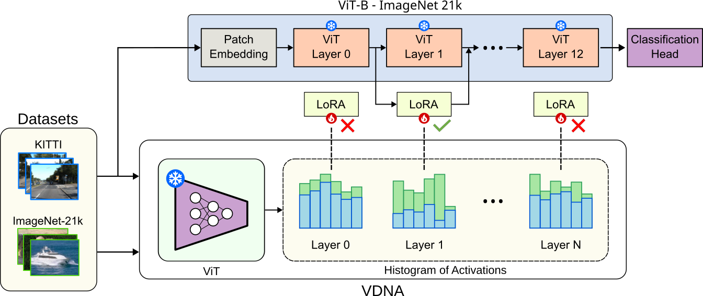
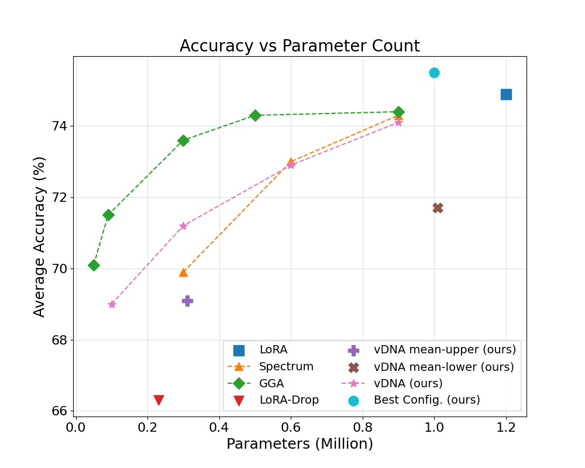
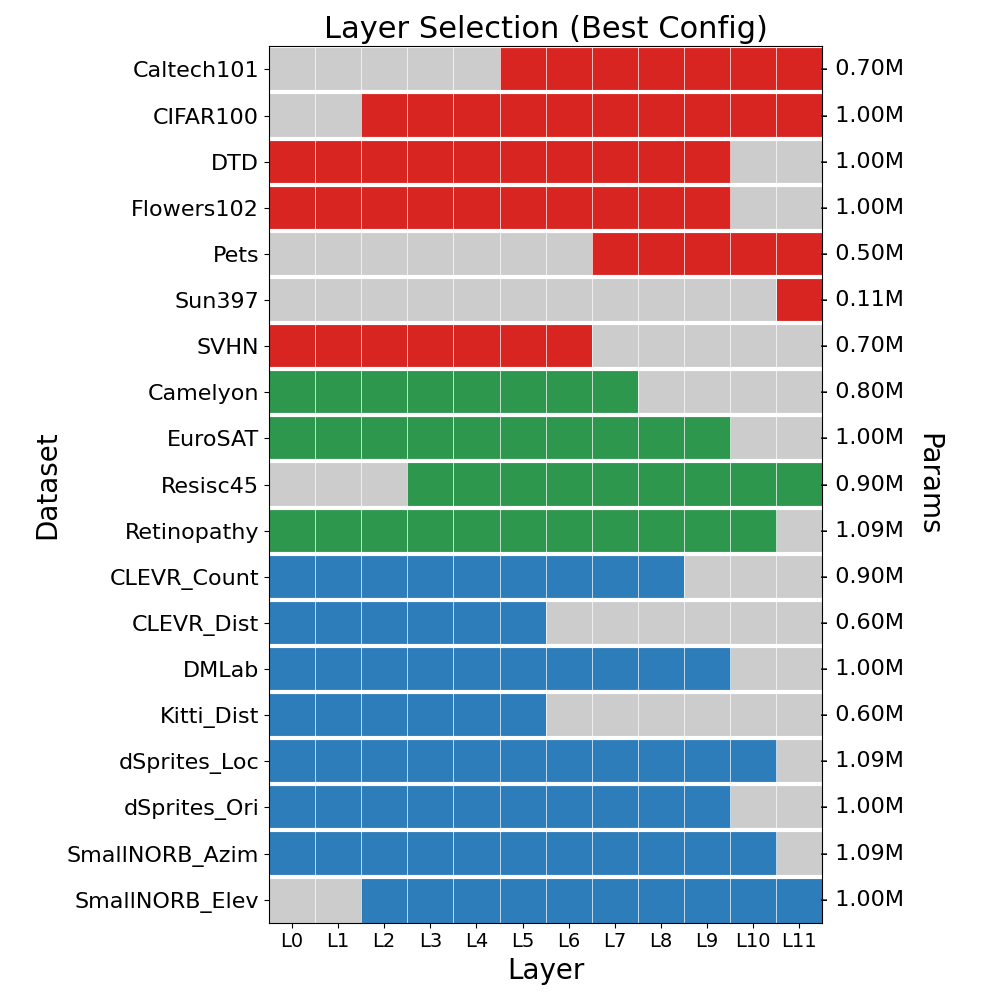

# Guided-PEFT: VDNA-Guided Layer Selection for Parameter-Efficient Fine-Tuning

Guided-PEFT explores parameter-efficient fine-tuning (PEFT) strategies for Vision Transformers by selecting the most relevant layers for adaptation using Visual DNA ([VDNA](https://github.com/bramtoula/vdna)) scores.

Instead of applying LoRA uniformly across all transformer layers, Guided-PEFT identifies layers that exhibit the largest distribution shift between a source and target dataset and applies LoRA only to those layers. This reduces the number of trainable parameters while maintaining competitive downstream performance.

The method is evaluated on the VTAB benchmark and compared against standard LoRA, [Spectrum](https://github.com/QuixiAI/spectrum), Gradient-Guided Adaptation ([GGA](https://arxiv.org/pdf/2410.15858)), and [LoRA-Drop](https://arxiv.org/pdf/2402.07721).

---

## Method Overview

The approach consists of three steps:

1. Compute VDNA representations for the source and target datasets.
2. Measure the distribution shift between datasets using Earth Mover's Distance (EMD).
3. Select the layers with the highest EMD scores and apply LoRA adaptation only to those layers.

The intuition is that layers exhibiting the largest feature-distribution shift are likely to benefit the most from adaptation during transfer learning.

<p align="center">
  
</p>

---


## Quick Start

Follow these steps to run Guided-PEFT:

1. **Install dependencies** by following the [Installation](#installation) instructions.

2. **Configure the VTAB datasets.** Update the Hugging Face repository reference in `VTABDataModule` to point to your personal Hugging Face dataset repository. See [Dataset Setup](#dataset-setup) for details.

3. **Compute VDNA scores** for the source and target datasets using the commands in [Usage](#usage).

4. **Run fine-tuning** with VDNA-guided layer selection or explore alternative layer-ranking strategies using the provided training scripts.

For detailed instructions and example commands, see the [Usage](#usage) section.


---

## Installation

```bash
git clone https://github.com/hl49/guided-peft.git
cd guided-peft
pip install -r requirements.txt
```

---

## Dataset Setup

The VTAB datasets used in this project are loaded through Hugging Face Datasets.

Before running any experiments, update the dataset repository reference in `VTABDataModule` to point to your own Hugging Face dataset repository containing the VTAB datasets.

For example:

```python
dm = VTABDataModule(
    dataset_name=f"username/vtab_{dataset}"
)
```

Replace the default repository identifier with your own dataset location.

> **Note**
>
> The original VTAB datasets are not distributed as part of this repository. Users are expected to upload the datasets to a personal Hugging Face repository (or adapt the data loading code accordingly) before running the experiments.

---

## Usage

### 1. Compute VDNA Scores

Compute VDNA representations for the source dataset ([imagenet-mini](https://www.kaggle.com/datasets/ifigotin/imagenetmini-1000)):

```bash
python tools/compute_vdna.py imagenet-mini \
    --imagenet-path /path/to/imagenet
```

Compute VDNA representations for the [VTAB](https://github.com/google-research/task_adaptation) target datasets:

```bash
python tools/compute_vdna.py vtab
```

Compute Earth Mover's Distance (EMD) between source and target datasets:

```bash
python tools/compute_vdna.py emd
```

---

### 2. Train Using VDNA-Guided Layer Selection

Apply LoRA only to the selected layers:

```bash
python train_on_task.py fit \
    --config configs/base.yaml \
    --config configs/models/vit_base_orig.yaml \
    --config configs/data/cifar100.yaml \
    --trainer.logger.init_args.name=guided_peft_cifar100 \
    --model.adaptation_mode=lora \
    --model.lora_target_modules="[
        'blocks.0.attn.qkv',
        'blocks.0.attn.proj',
        'blocks.0.mlp.fc1',
        'blocks.0.mlp.fc2'
    ]"
```

---

### 3. Layer-wise LoRA Sweep

Run a layer-wise sweep to evaluate individual layer importance:

```bash
python launch_sweep.py fit \
    --config configs/base.yaml \
    --config configs/models/vit_base_orig.yaml \
    --config configs/data/cifar100.yaml \
    --trainer.logger.init_args.name=sweep_cifar100 \
    --model.adaptation_mode=lora
```

---

### 4. Alternative Layer Scoring Methods

The framework also supports alternative layer-importance estimation methods.

#### LoRA-Drop

```bash
python train_on_task.py fit \
    --config configs/base.yaml \
    --config configs/models/vit_base_orig.yaml \
    --config configs/data/cifar100.yaml \
    --trainer.logger.init_args.name=lora_drop_cifar100 \
    --model.adaptation_mode=lora-drop
```

#### Gradient-Guided Adaptation (GGA)

Support for GGA-based layer ranking is also included and can be used as an alternative to VDNA-based selection.

---

## Results

Guided-PEFT was evaluated against the following baselines:

* Full-layer LoRA
* Spectrum
* Gradient-Guided Adaptation (GGA)
* LoRA-Drop
* Best Configuration (exhaustive layer search)

### Overall Performance

<p align="center">
  
</p>

The results show that exhaustive layer search achieves the highest performance, but requires a prohibitively large search space. Guided-PEFT aims to approximate these strong configurations using dataset-aware layer selection while significantly reducing computational cost.

### Best Layer Configurations

<p align="center">
  
</p>

The figure illustrates the optimal layer combinations discovered for each VTAB dataset.

* Colored cells indicate adapted layers.
* Gray cells indicate frozen layers.
* Dataset categories are color-coded:

  * Natural (red)
  * Specialized (blue)
  * Structured (green)

The parameter count associated with each optimal configuration is shown alongside the corresponding dataset.

---

## Key Findings

* Layer importance varies significantly across target datasets.
* Adapting only a subset of transformer layers can achieve competitive performance with substantially fewer trainable parameters.
* Dataset-aware layer selection consistently outperforms random layer selection.
* VDNA provides an efficient mechanism for identifying promising adaptation layers prior to fine-tuning.

---

## Acknowledgements

This project builds upon several excellent open-source projects:

* [Visual DNA](https://github.com/bramtoula/vdna)
* [VTAB Benchmark](https://github.com/google-research/task_adaptation)
* [Spectrum](https://github.com/QuixiAI/spectrum)
* [Gradient-Guided Adaptation (GGA)](https://arxiv.org/pdf/2410.15858)
* [LoRA-Drop](https://arxiv.org/pdf/2402.07721)
* [Hugging Face Datasets](https://huggingface.co/)
* [Weights & Biases](https://wandb.ai/)
